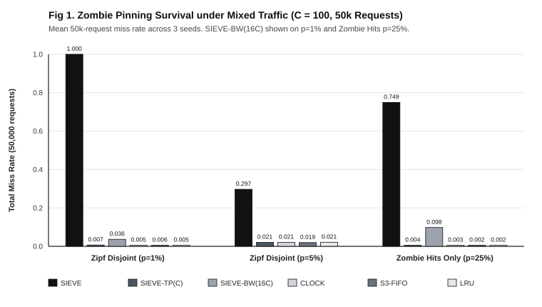
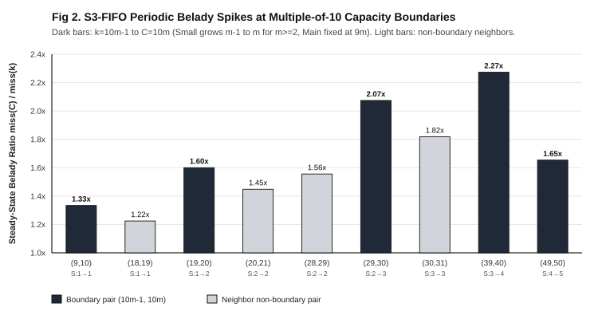
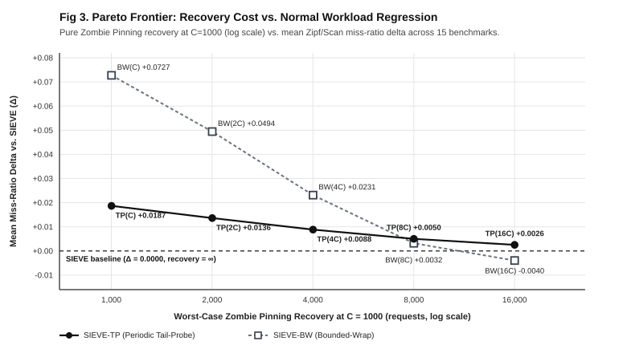

# Hand Starvation & Zombie Pinning in SIEVE (Cache Anomalies Research)

[](https://github.com/JOsee321/cache-anomalies/actions/workflows/verify.yml)

Repository: <https://github.com/JOsee321/cache-anomalies>

Formal proofs, exact state-graph verification, cross-language simulators (Python & Go), and Pareto-evaluated mitigations for **unbounded Belady anomalies** in modern cache eviction policies (**SIEVE**, **S3-FIFO**, **CLOCK**, **2-bit CLOCK**, **SecondChance**, **FIFO**, **LRU**).

## The Zombie Pinning / Hand Starvation Mechanism

For every $3 \le k < C$, the explicit trace `prefix = [z_1..z_{C-2}, A, B, z_1..z_{C-2}]` followed by repeated `cycle = [D, A, B]` locks `SIEVE(C)` at **100% miss rate** while `SIEVE(k)` achieves **0% miss rate**:

```text
  head (newest)                                            tail (oldest)
  +---------+     +---------+     +---------+         +---------+
  |  B (F)  | <-> |  A (F)  | <-> | z_{C-2} | <-> ... |  z_1(F) |
  +---------+     +---------+     +---------+         +---------+
                       ^
                     hand (trapped at index 1!)

  Next miss (D):
    1. hand evicts A (index 1 != head) -> hand = A.prev = B
    2. D inserted at head -> [D(F), B(F), z_{C-2}(F), ..., z_1(F)]
    3. hand now points to B (still index 1!) -> C-2 zombies never swept!
```

## Comparative Atlas (Exact + 5,000-Cycle Cross-Verified)

| Policy | Zombie Pinning (`k=3..500 < C`) | `0% miss(k)` vs `>0% miss(C)` | Exact `(2,3,m=4)` Max Ratio | Max Observed Finite Ratio |
| :--- | :---: | :---: | :---: | :---: |
| **`SIEVE`** | `0.00% / 100.00%` (378/378 + extremes) | **Yes** ($\forall 3 \le k < C$) | `3/2` (`1.5000`) | **$\infty$** (`0%` vs `100%`) |
| **`FIFO`** | `0.00% / 0.00%` (immune) | No (Theorem 3) | `1/1` (none) | `2.0000` (`3,4,m=5`) |
| **`CLOCK`** | `0.00% / 0.00%` (immune) | No (Theorem 3) | `3/2` (`1.5000`) | `1.5000` (`2,3,m=4`) |
| **`CLOCK2`** | `0.00% / 0.00%` (immune) | No (Theorem 3) | `2/1` (`2.0000`) | `2.0000` (`2,3` & `3,4`) |
| **`SecondChance`** | `0.00% / 0.00%` (immune) | No (Theorem 3) | `3/2` (`1.5000`) | `1.5000` (`2,3,m=4`) |
| **`S3-FIFO`** | `0.00% / 0.00%` (immune) | No (Theorem 3) | `15/8` (`1.8750`) | **`2.2727`** (`39,40` `Small` boundary) |

## Symmetric Mitigation Pareto Frontier (`{C, 2C, 4C, 8C, 16C}`)

Evaluated over 15 normal configurations (Zipf $\alpha \in \{0.6, 0.8, 1.0, 1.2\}$ and Zipf+Scan $\alpha=0.9$, $C \in \{100, 500, 1000\}$, `200,000` requests $\times$ 3 seeds) vs. worst-case recovery at `C=1000` and `zombie_hits_only (p=25%)`:

| Policy | Avg Miss Ratio | Avg $\Delta$ vs `SIEVE` | Max $\Delta$ | Pure `C=1000` Recov (reqs) | `ZHit 25%` `C=100` Unwrap / Miss |
| :--- | :---: | :---: | :---: | :---: | :---: |
| **`SIEVE`** *(baseline)* | `0.4963` | `+0.0000` | `+0.0000` | $\infty$ | $\infty$ / `37,464` |
| `SIEVE-BW(C)` | `0.5691` | `+0.0727` | `+0.1132` | `1,001` | `114` / `204` |
| `SIEVE-BW(2C)` | `0.5458` | `+0.0494` | `+0.0915` | `2,001` | `251` / `306` |
| `SIEVE-BW(4C)` | `0.5194` | `+0.0231` | `+0.0641` | `4,001` | `514` / `508` |
| `SIEVE-BW(8C)` | `0.4995` | `+0.0032` | `+0.0388` | `8,001` | `1,045` / `908` |
| **`SIEVE-BW(16C)`** | **`0.4924`** | **`-0.0040`** | `+0.0175` | `16,001` | `6,386` / `4,891` |
| **`SIEVE-TP(C)`** | `0.5150` | `+0.0187` | `+0.0378` | **`1,001`** | **`116` / `210`** |
| **`SIEVE-TP(2C)`** | `0.5099` | `+0.0136` | `+0.0334` | `2,001` | `254` / `310` |
| **`SIEVE-TP(4C)`** | `0.5052` | `+0.0088` | `+0.0303` | `4,001` | `516` / `511` |
| `SIEVE-TP(8C)` | `0.5013` | `+0.0050` | `+0.0212` | `8,001` | `1,047` / `902` |
| **`SIEVE-TP(16C)`** | `0.4989` | `+0.0026` | **`+0.0138`** | `16,001` | **`2,129` / `1,709`** |

## Key Figures







## Quick Reproduction

Requirements: Python 3.10+ and Go 1.22+ (no external Python packages required).

```bash
# Fast end-to-end verification (< 30s): unit tests, parity, 378 Zombie-Pinning grid,
# extreme scales, cross-verification of all Stage 1-5 witnesses, and SVG figures.
python reproduce.py --quick

# Full pipeline from scratch (re-runs all exact Go solvers, evolutionary searches,
# mixed-traffic simulations, 200k*3-seed Pareto benchmarks, and Python checks).
python reproduce.py --full
```

## Repository Layout

- [`sim/`](sim/) — Explicit doubly-linked list Python implementations (`SIEVE`, `SIEVE-BW`, `SIEVE-TP`, `FIFO`, `CLOCK`, `CLOCK2`, `SecondChance`, `S3-FIFO`, `LRU`) and unit tests.
- [`verifiers/`](verifiers/) — Independent Go module (`sieve-verifier`) with DLL implementations, exact state-graph solvers, evolutionary trace searchers, and benchmark runners.
- [`experiments/`](experiments/) — Python verification, cross-check, and vector SVG figure generation scripts.
- [`results/`](results/) — JSON artifacts, stage-by-stage technical reports (`tahap1`–`tahap4`, `tahap5_symmetry.json`), and direct [`libCacheSim` conformance audit](results/libcachesim_conformance.md) against upstream commit `4b66d97`.
- [`figures/`](figures/) — Publication-ready monochrome vector SVGs (`fig1`–`fig3`).
- [`paper/`](paper/) — Short conference paper with formal proofs ([`paper.md`](paper/paper.md) and [`main.tex`](paper/main.tex)).
